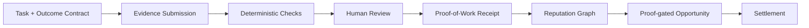
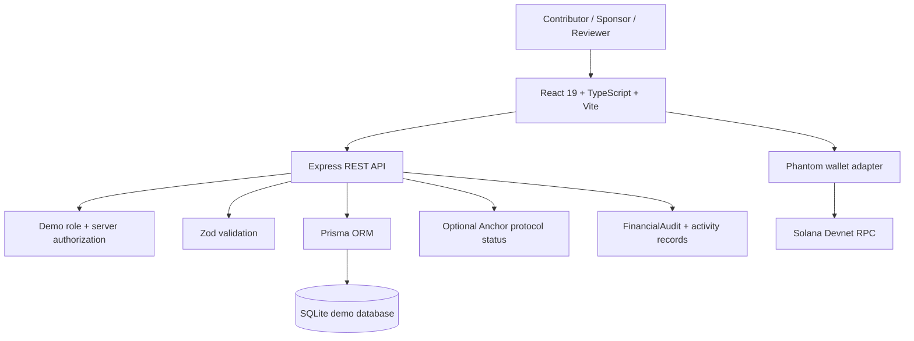
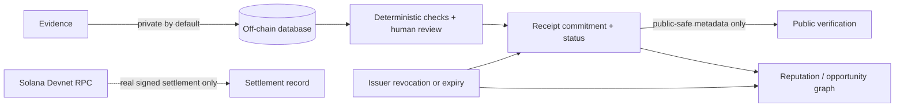
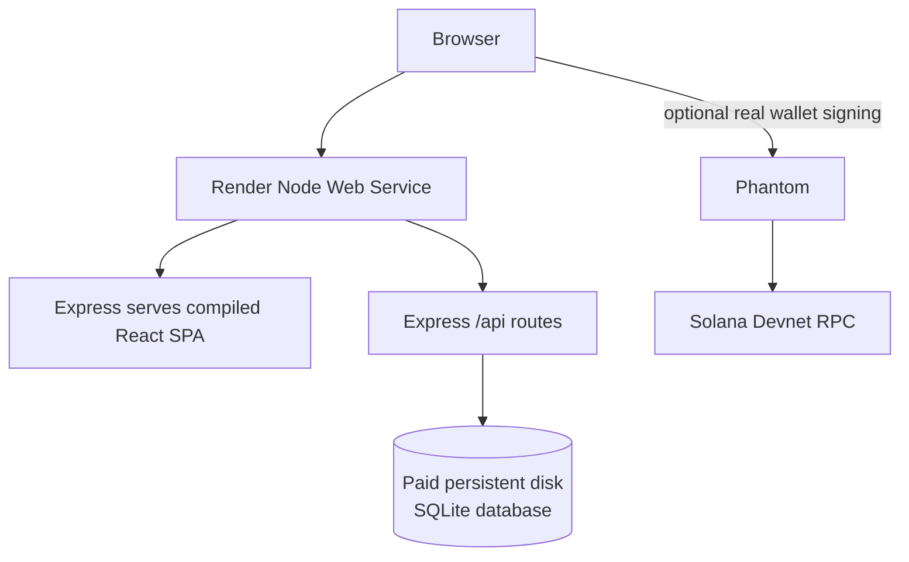

# ProofMesh

<p align="center">
  <strong>Proof once. Build reputation everywhere.</strong><br />
  Outcome-bound work verification, portable Proof-of-Work Receipts, and proof-gated opportunities for Solana teams.
</p>

<p align="center">
  <a href="https://proofmesh-9t5fuy66.manus.space">Open hosted preview</a> ·
  <a href="docs/DEMO_SCRIPT.md">3-minute demo</a> ·
  <a href="docs/ARCHITECTURE.md">Architecture</a> ·
  <a href="docs/THREAT_MODEL.md">Threat model</a> ·
  <a href="docs/INTEGRATION.md">Integration API</a>
</p>

<p align="center">
  
  
  
  
  
</p>

> **Judge quickstart:** open the hosted preview, choose **Try the Demo**, stay in Demo Mode, and follow the path **task → evidence → checks → reviewer approval → receipt → Proof-to-Access**. No wallet or Devnet SOL is required for the simulated walkthrough.

## Contents

- [What ProofMesh does](#what-proofmesh-does)
- [Judge quickstart](#judge-quickstart)
- [Core workflow](#core-workflow)
- [Implemented features](#implemented-features)
- [Architecture](#architecture)
- [Repository map](#repository-map)
- [Local setup](#local-setup)
- [API overview](#api-overview)
- [Real Devnet and Anchor boundary](#real-devnet-and-anchor-boundary)
- [Security and privacy](#security-and-privacy)
- [Testing](#testing)
- [Render deployment](#render-deployment)
- [Evaluation guide](#evaluation-guide)
- [Roadmap and business potential](#roadmap-and-business-potential)
- [Limitations](#limitations)

## What ProofMesh does

Web3 teams often verify work in disconnected tools: a task description in one place, evidence in another, reviewer decisions in chat, and payment records somewhere else. ProofMesh creates one outcome-bound finish line:

1. A sponsor defines an **Outcome Contract** with measurable acceptance criteria.
2. A contributor submits evidence without exposing private material by default.
3. Deterministic checks and a human reviewer validate the result.
4. A portable **Proof-of-Work Receipt** records the accepted capability.
5. Active receipts can satisfy future **Proof Recipes** and unlock new opportunities.
6. A reputation graph connects completed work, proofs, issuers, and opportunities.
7. Settlement is either clearly simulated in Demo Mode or explicitly signed and confirmed on Solana Devnet.

The product concept is **reusable proof**, not an arbitrary profile score: reputation is derived from verified completed work and its receipt history.

## Judge quickstart

### Recommended 3-minute path

1. Open the [hosted preview](https://proofmesh-9t5fuy66.manus.space).
2. Select **Try the Demo**. The landing page intentionally separates this from **Connect Solana Devnet**.
3. In the workspace, open the active task and inspect its acceptance criteria and proof requirement.
4. Use the contributor role to submit evidence, then switch to the reviewer role.
5. Run deterministic checks, review the evidence summary, approve the submission, and inspect the simulated settlement panel.
6. Open **Proofs** to see the Proof Passport, including active and revoked receipts.
7. Open **Proof-to-Access** or **Graph** to see why an opportunity is qualified, which proof supports it, what is missing, and how revocation affects downstream access.
8. Use **Settings → Demo Mode → Reset Demo** to restore deterministic fixtures.

Full narration is in [`docs/DEMO_SCRIPT.md`](docs/DEMO_SCRIPT.md). Demo transactions are labeled **DEMO — Simulated Transaction** and never call Solana.

> **Missing media:** no demo video, pitch video, or transaction-specific Explorer link is committed because none has been verified. Add those URLs only after the assets actually exist.

## Core workflow



The trust model is deliberately bounded: a receipt proves that ProofMesh recorded a verification decision and its supporting commitments. It does not independently prove that submitted evidence is truthful in the physical world.

## Implemented features

| Surface                 | What is implemented                                                                                                                                               | Where to inspect                                                                                                                                                                           | Truth boundary                                                                                |
| ----------------------- | ----------------------------------------------------------------------------------------------------------------------------------------------------------------- | ------------------------------------------------------------------------------------------------------------------------------------------------------------------------------------------ | --------------------------------------------------------------------------------------------- |
| Outcome Contracts       | Versioned acceptance criteria, evidence requirements, automated checks, reviewer checks, policy hash, and recipe provenance.                                      | [`server/services/recipeService.ts`](server/services/recipeService.ts), [`server/services/workflowService.ts`](server/services/workflowService.ts)                                         | Server-validated prototype logic.                                                             |
| ALL / ANY Proof Recipes | Sponsors can define compound proof requirements. `ALL` requires every condition; `ANY` requires one qualifying condition.                                         | [`client/src/pages/Tasks.tsx`](client/src/pages/Tasks.tsx), [`server/services/accessService.ts`](server/services/accessService.ts)                                                         | Evaluates persisted active public receipt metadata.                                           |
| Evidence and review     | Contributors submit evidence; reviewers run deterministic checks, request changes, approve, or reject.                                                            | [`client/src/pages/SubmissionDetail.tsx`](client/src/pages/SubmissionDetail.tsx), [`server/services/verificationService.ts`](server/services/verificationService.ts)                       | GitHub/deployment checks are deterministic simulations unless a live provider is configured.  |
| Proof Passport          | Active and revoked receipts, credential commitments, reuse counts, public verification, and completed-work history.                                               | [`client/src/pages/Proofs.tsx`](client/src/pages/Proofs.tsx), [`server/services/proofService.ts`](server/services/proofService.ts)                                                         | Demo commitments are application-level; they are not claims of deployed on-chain credentials. |
| Proof-to-Access         | Eligibility explanations show supporting proofs, missing requirements, active/revoked status, and privacy-safe disclosure boundaries.                             | [`client/src/pages/ProofAccess.tsx`](client/src/pages/ProofAccess.tsx), [`server/services/accessService.ts`](server/services/accessService.ts)                                             | Revoked and expired credentials are excluded from qualification.                              |
| ProofGraph              | API-backed graph relationships connect contributors, work, proofs, issuers, and opportunities; revoked branches show downstream impact.                           | [`client/src/pages/ProofGraph.tsx`](client/src/pages/ProofGraph.tsx), [`server/services/reputationService.ts`](server/services/reputationService.ts)                                       | Derived from persisted SQLite records, not decorative fixtures.                               |
| Opportunity Engine      | Explainable matches include qualification status, supporting proofs, missing proofs, and revocation/expiry exclusions.                                            | [`server/services/reputationService.ts`](server/services/reputationService.ts), `/api/opportunities`                                                                                       | Prototype matching rules are deterministic and inspectable.                                   |
| Wallet and Devnet       | Phantom adapter, Devnet RPC health, live balance, explicit connect/reject/wrong-network states, transaction confirmation, and Explorer links for real signatures. | [`client/src/contexts/SolanaProvider.tsx`](client/src/contexts/SolanaProvider.tsx), [`client/src/components/DevnetTransactionPanel.tsx`](client/src/components/DevnetTransactionPanel.tsx) | Real mode never silently falls back to simulation.                                            |
| Agent governance        | Simulated agent requests with category, recipient, budget, allowlist, threshold approval, and no self-approval.                                                   | [`client/src/pages/AgentDemo.tsx`](client/src/pages/AgentDemo.tsx), [`server/services/agentService.ts`](server/services/agentService.ts)                                                   | Agent execution is simulated; it cannot approve work or move funds autonomously.              |
| Audit and metrics       | Financial audit events, real SQLite-derived dashboard metrics, activity timeline, and deterministic demo reset.                                                   | [`server/services/metricsService.ts`](server/services/metricsService.ts), [`server/api.ts`](server/api.ts)                                                                                 | Metrics are database-derived in the running instance.                                         |

## Architecture

### Application architecture



### Data and trust flow



### Deployment architecture



The checked-in [`render.yaml`](render.yaml) describes this single-service deployment. Render Free services cannot preserve SQLite files; the current Blueprint therefore uses a paid persistent disk. For horizontal scaling, migrate Prisma to managed Postgres.

## Repository map

```text
client/src/
  components/       Shared UI, wallet, transaction, status, and shell components
  contexts/         Demo mode, role, theme, and Solana provider state
  hooks/             API, wallet diagnostics, and query hooks
  pages/             Landing, dashboard, tasks, submissions, proofs, access, graph
server/
  api.ts            REST route registration and API error boundary
  services/         Authorization, recipes, verification, proofs, access, reputation
prisma/
  schema.prisma     Task, contract, submission, proof, escrow, audit, and graph data
  seed.ts           Deterministic Demo Mode fixtures
programs/
  proofmesh_protocol/  Production-structured Anchor credential/escrow source
scripts/
  ensure-demo-data.ts  Guarded one-time empty-database initializer
docs/
  ARCHITECTURE.md, DEMO_SCRIPT.md, INTEGRATION.md, RENDER_DEPLOYMENT.md
  THREAT_MODEL.md, LIMITATIONS.md
```

## Local setup

### Prerequisites

- Node.js 22+
- pnpm
- SQLite for local Demo Mode
- Phantom only for Real Devnet Mode
- Rust and Anchor only if compiling the optional protocol workspace

### Install and seed

```bash
pnpm install
export DATABASE_URL="file:./dev.db"
pnpm prisma generate
pnpm db:push
pnpm db:seed
```

The seed is intentionally destructive for local Demo Mode: it resets the local fixture database. Do not run `pnpm db:seed` against a database containing real user data.

### Run and build

```bash
pnpm dev
pnpm check
pnpm test
pnpm build
```

For a production-like local process:

```bash
DATABASE_URL="file:./dev.db" NODE_ENV=production node dist/index.js
```

### Environment configuration

The repository does not commit a secret-bearing `.env` file. Common variables are:

| Variable                     | Use                                                                                          |
| ---------------------------- | -------------------------------------------------------------------------------------------- |
| `DATABASE_URL`               | Prisma SQLite URL locally or on the Render persistent disk.                                  |
| `VITE_SOLANA_RPC_URL`        | Optional public Solana Devnet RPC override.                                                  |
| `CORS_ORIGIN`                | Exact comma-separated origins for split-origin clients; leave unset for same-origin hosting. |
| `SEED_DEMO_DATA`             | Render demo only: seed an empty database once when `true`; never resets non-empty data.      |
| `SOLANA_PROTOCOL_PROGRAM_ID` | Only after an Anchor program is deployed and verified executable on Devnet.                  |
| `SOLANA_CREDENTIAL_PROGRAM`  | Optional server-side credential program configuration.                                       |
| `GITHUB_TOKEN`               | Optional server-side GitHub API access; never expose it as `VITE_*`.                         |

## API overview

All API responses use `{ data: ... }` on success and `{ error: { code, message } }` on failure. Demo role selection uses the `x-demo-role` header; organization identity is resolved server-side and is never trusted from the browser.

| Area                | Representative endpoints                                                                                                                        |
| ------------------- | ----------------------------------------------------------------------------------------------------------------------------------------------- |
| Health and protocol | `GET /api/health`, `GET /api/solana/protocol-status`                                                                                            |
| Tasks and contracts | `GET /api/tasks`, `POST /api/tasks`, `GET /api/tasks/:id/contract`, `POST /api/contracts`                                                       |
| Eligibility         | `GET /api/tasks/unlocked`, `GET /api/tasks/:id/eligibility`, `POST /api/tasks/:id/apply`, `GET /api/opportunities`                              |
| Submissions         | `GET /api/submissions`, `POST /api/submissions/:id/evidence-submit`, `POST /api/submissions/:id/run-checks`, `POST /api/submissions/:id/review` |
| Proofs              | `GET /api/proofs`, `GET /api/proofs/:id`, `POST /api/proofs/:id/revoke`, `GET /api/verify/:id`                                                  |
| Reputation          | `GET /api/reputation/graph`, `GET /api/reputation/history`                                                                                      |
| Metrics and demo    | `GET /api/dashboard/metrics`, `GET /api/metrics/real`, `POST /api/demo/reset`                                                                   |

See [`docs/INTEGRATION.md`](docs/INTEGRATION.md) for the portable reputation integration contract.

## Real Devnet and Anchor boundary

Real Devnet Mode uses Phantom and Solana Devnet RPC. It reads the actual wallet public key and balance, asks Phantom to sign, confirms the transaction, and exposes an Explorer link for a confirmed signature. It never fabricates a successful transaction or silently falls back to Demo Mode.

The repository also includes a production-structured Anchor workspace at [`programs/proofmesh_protocol`](programs/proofmesh_protocol):

- Credential PDA derived from issuer, recipient, and proof hash.
- Issuer authorization and explicit active/revoked state.
- Expiry checks, fixed-size commitments, and replay-safe transitions.
- Escrow PDA with sponsor, reviewer, recipient, mint, amount, claim, approval, and release constraints.

The Anchor program is **not claimed as deployed or audited**. The hosted prototype therefore identifies the current Real Devnet transfer as legacy SPL settlement infrastructure, not credential-gated Anchor escrow. The API verifies configured program status through `/api/solana/protocol-status` before describing a deployment as available.

If Anchor tooling is installed:

```bash
anchor build
anchor test --provider.cluster localnet
# only after deployment and wallet funding:
anchor test --provider.cluster devnet
```

## Security and privacy

- Server-side authorization checks every workflow action.
- Zod validates task, recipe, evidence, wallet, payout, and agent inputs.
- Browser-supplied organization IDs are not trusted.
- Financial state changes use idempotency-aware paths and `FinancialAudit` records.
- Public verification exposes receipt commitments and status, not private evidence.
- Proof-to-Access evaluates active, non-expired public metadata and excludes revoked receipts.
- Agent requests are bounded by allowlists, recipients, budgets, and human approval thresholds.
- Wallet rejection and RPC failure are recoverable states; a failed or rejected transaction is not recorded as successful.

Read [`docs/THREAT_MODEL.md`](docs/THREAT_MODEL.md) for threats, mitigations, and open risks.

## Testing

The current verified application suite contains **24 passing tests** across Demo Mode, API services, wallet diagnostics, recipe validation, access policy, reputation graph derivation, settlement safety, and mode isolation:

```bash
pnpm check
pnpm test
pnpm build
```

The production-like smoke checks also verify fresh Prisma migrations, guarded first-run seeding, repeat-startup seed skipping, `/api/health`, seeded task retrieval, unknown API 404 behavior, direct SPA routes, and documentation links.

## Render deployment

Use the checked-in [`render.yaml`](render.yaml) to deploy one Node Web Service serving both the React SPA and Express API:

- Build: `pnpm install --frozen-lockfile --prod=false && pnpm prisma generate && pnpm build`
- Start: `pnpm prisma migrate deploy && pnpm render:init && pnpm start`
- Health check: `/api/health`
- Database: `file:/opt/render/project/src/data/proofmesh.db`
- Demo initialization: `SEED_DEMO_DATA=true`, guarded to empty databases only
- Persistent disk: `/opt/render/project/src/data`

The persistent-disk SQLite configuration requires a paid Render instance. Follow [`docs/RENDER_DEPLOYMENT.md`](docs/RENDER_DEPLOYMENT.md) for environment variables, migration behavior, health verification, and the Postgres migration path.

## Evaluation guide

| Criterion                         | ProofMesh evidence                                                                                                                          |
| --------------------------------- | ------------------------------------------------------------------------------------------------------------------------------------------- |
| Functionality and code quality    | Full task lifecycle, recipe validation, verification, review, receipts, access checks, API services, TypeScript validation, and 24 tests.   |
| Potential ecosystem impact        | Portable receipts and a documented reputation API can connect bounty platforms, DAOs, developer tooling, and credential issuers.            |
| Novelty and differentiation       | Reusable proof is a capability primitive: one accepted outcome can unlock later work without exposing private evidence.                     |
| UX and blockchain integration     | Judge-friendly Demo Mode plus an explicit Real Devnet path with Phantom state, RPC diagnostics, confirmation, and no fabricated signatures. |
| Open-source composability         | Prisma schema, REST endpoints, integration contract, architecture docs, and Anchor PDA source are inspectable.                              |
| Business model and sustainability | Proposed future model: organization subscriptions, verification volume pricing, and ecosystem/API plans; no revenue is claimed today.       |

## Roadmap and business potential

### Completed in this prototype

- Outcome Contracts, Proof Recipes, deterministic verification, reviewer flow, and settlement records.
- Proof Passport with active/revoked state and public verification.
- ProofGraph and explainable opportunity matching from persisted records.
- Phantom/Solana Devnet wallet integration with explicit simulation boundaries.
- Anchor credential/escrow source, threat model, integration docs, Render Blueprint, and guarded demo initialization.

### Next practical milestones

1. Deploy and independently audit the Anchor program; connect generated IDL instructions to the UI.
2. Replace deterministic provider checks with signed GitHub, CI, deployment, and attestation integrations.
3. Migrate production persistence from SQLite disk to managed Postgres and add operational backups.
4. Add organization-level accounts, passkey/authentication, issuer policies, and credential export/import.
5. Pilot with one DAO, bounty platform, or Solana developer-tools team.

Potential integrations include DAO contributor programs, bounty marketplaces, code-hosting/CI providers, security attestations, credential issuers, and applications that want proof-gated access to work or grants.

