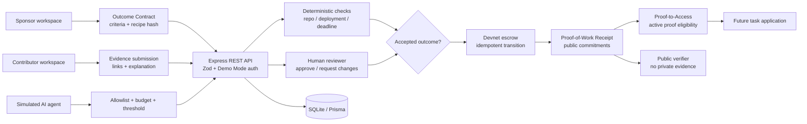

# ProofMesh architecture

ProofMesh separates **policy**, **verification**, **settlement**, and **public disclosure**. The browser is an interaction surface; it does not decide eligibility, approve payouts, or choose an organization.

## Trust boundaries

The browser may submit a task identifier, evidence links, role header, or wallet intent. The server resolves the organization from the controlled Demo Mode identity, validates all request bodies with Zod, and re-checks ownership and role permissions before each state transition.

Private evidence remains associated with a submission. Public proof verification returns only the receipt status, verification commitment, task metadata, reviewer attribution where permitted, and settlement metadata. Proof-to-Access returns the minimum information required to explain eligibility: the qualifying proof identifier, task title, active status, category, chain, and hash commitment. It explicitly states what is not disclosed.

## Production replacement points

The local SQLite database should be replaced with a managed database and row-level policies. Demo Mode should be replaced with authenticated sessions and server-derived organization membership. Deterministic simulations should be replaced with provider-attested GitHub, deployment, and benchmark checks. Simulated settlement should be replaced with an audited escrow program and configured SPL token mint. The current OpenRouter path should remain server-side and should store model provenance without granting the model approval or settlement authority.

## Anchor protocol boundary

`programs/proofmesh_protocol` is the on-chain source of truth for the next production integration. Credential PDAs use `credential + issuer + recipient + proof_hash`; escrow PDAs use `escrow + task_hash`; token vaults are owned by the escrow PDA. Anchor constraints enforce PDA derivation, issuer/reviewer signer authorization, recipient matching, mint and token-account authority, and one-way funded → claimed → approved → released transitions. The credential must be active at claim time, so revocation blocks future claims.

The current React adapter still uses the existing real SPL transfer path because no deployed protocol IDL/program is present in this environment. `/api/solana/protocol-status` verifies the configured Devnet program address before the UI can describe the Anchor program as deployed. No local database receipt is treated as an on-chain credential until a confirmed program transaction and account read are wired through the generated IDL.
